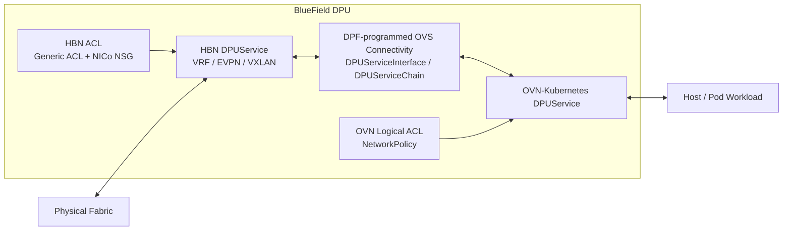

🔍 **Understanding DPU-based network isolation in a multi-tenant AI Factory.**

> NVIDIA BlueField can enforce network isolation before traffic reaches the host.
>
> HBN provides DPU-side routing and EVPN/VXLAN functions, NICo provides tenant-facing VPC and NSG abstractions, and OVN-Kubernetes provides Kubernetes workload networking and `NetworkPolicy`.
>
> The key is to separate **routing**, **tenant ACL policy**, **workload ACL policy**, and **service-chain traffic steering**.

---

## ① HBN Is the DPU Network Service

HBN is a `DPUService` that provides routing and network functions on BlueField.

According to the [DPF architecture overview](https://networking-docs.nvidia.com/dpf/26.4.0/overview), DPU services are deployed into the `DPUCluster` and run on DPU nodes.

HBN can provide both native L3 routing and EVPN/VXLAN overlay functions.

```text
HBN DPUService

 ├─ Native L3 / BGP
 ├─ VRF
 ├─ EVPN
 ├─ VXLAN / VNI
 └─ ACL / NAT
```

HBN ACL is therefore **not an underlay-only firewall function**.

It is a generic HBN dataplane filtering capability that can be applied at supported HBN interfaces depending on the traffic path and ACL type.

NVUE is used to configure this HBN network state.

```text
NVUE
  ↓
HBN configuration
  ↓
HBN dataplane enforcement
```

Official reference:

- [NVIDIA HBN Service Configuration](https://networking-docs.nvidia.com/doca/archive/3-5-0/hbn-service-configuration)

---

## ② NICo Uses a Pure Type-5 EVPN L3 Overlay

NICo Ethernet VPC isolation is implemented through HBN.

NVIDIA describes the tenant network as a:

> **pure Type-5 EVPN IP-prefix overlay**

This means NICo does **not** extend a tenant L2 broadcast domain across the physical fabric.

Instead, each DPU maintains a local instance of the tenant VPC VRF and exchanges IP-prefix reachability using EVPN Type-5 routes.

```text
                    VPC-A

DPU-1                                      DPU-2

┌─────────────────┐                    ┌─────────────────┐
│ VRF-A           │                    │ VRF-A           │
│ L3VNI: 100001   │                    │ L3VNI: 100001   │
│ RT: VPC-A       │                    │ RT: VPC-A       │
└────────┬────────┘                    └────────┬────────┘
         │                                      │
         │        EVPN Type-5 Routes            │
         └──────────────────────────────────────┘
                    │
                 VXLAN
                    │
              IP Underlay
```

The important EVPN route distinction is:

```text
EVPN Type-2
= MAC / MAC+IP Advertisement
= commonly used for endpoint reachability in L2 VNI overlays

EVPN Type-5
= IP Prefix Route
= prefix-based L3 reachability through an L3VNI
```

NICo uses the second model for tenant VPC routing.

Official references:

- [NICo Network Isolation](https://docs.nvidia.com/infra-controller/documentation/operations-day-2/network-isolation)
- [NICo VPC Network Virtualization](https://docs.nvidia.com/infra-controller/documentation/operations-day-2/managing-vp-cs/vpc-network-virtualization)

---

## ③ Tenant Addressing Is Different from VTEP Addressing

NICo separates **tenant attachment addressing** from **overlay transport addressing**.

For an instance interface, NICo allocates a `/31` network from the VPC prefix.

One address belongs to the instance side and the other belongs to the DPU SVI inside the corresponding VPC VRF.

```text
VpcPrefix
10.1.0.0/16

        ↓ carve /31

Host / Instance                     DPU / HBN

10.1.1.0/31  ────────────────────  10.1.1.1/31
                                        │
                                      SVI
                                        │
                                     VRF-A
```

The `/31` therefore provides the **local L3 attachment between the host and the DPU**.

It is part of the tenant's inner address space.

```text
Host IP
10.1.1.0/31

        ↕

DPU SVI
10.1.1.1/31
```

Within the same VRF, these attachment prefixes must be unique.

For example:

```text
VRF-A

Host-1 ↔ DPU
10.1.1.0/31

Host-2 ↔ DPU
10.1.1.2/31
```

However, overlapping tenant prefixes can exist in different VRFs.

```text
VRF-A
10.1.1.0/31

VRF-B
10.1.1.0/31
```

This is possible because each VRF maintains an independent routing table.

### Overlay Transport

The tenant `/31` is different from the VTEP address used to transport the overlay.

NICo provides a per-VPC DPU loopback, `vpc-dpu-lo`, which acts as the VPC-specific VTEP and EVPN Type-5 next hop.

```text
Tenant / Inner Address Space
────────────────────────────────

Host
10.1.1.0/31
    │
DPU SVI
10.1.1.1/31
    │
VRF-A
    │
EVPN Type-5
    │
L3VNI 100001


Overlay Transport
────────────────────────────────

vpc-dpu-lo
   │
 VTEP
   │
 VXLAN
   │
 IP Underlay
   │
 VXLAN
   │
 VTEP
   │
vpc-dpu-lo
```

For example:

```text
DPU-1                                      DPU-2

VRF-A                                      VRF-A
  │                                          │
L3VNI 100001                              L3VNI 100001
  │                                          │
vpc-dpu-lo                               vpc-dpu-lo
172.16.1.101                             172.16.1.102
  │                                          │
  └──────────── VXLAN / Underlay ────────────┘
```

The receiving DPU is the remote VTEP.

It decapsulates the VXLAN packet and maps the VNI back to the corresponding tenant VRF.

```text
DPU-1
VRF-A
   ↓
Route lookup
   ↓
EVPN Type-5 next hop
   ↓
VXLAN ENCAP
   ↓
VTEP-1
   │
   │ IP Underlay
   ▼
VTEP-2
   ↓
VXLAN DECAP
   ↓
L3VNI → VRF-A
   ↓
DPU-2 tenant attachment
```

Therefore, the layers can be summarized as:

```text
Tenant / Overlay Routing Domain
────────────────────────────────
Tenant Prefix
VRF
EVPN Type-5
L3VNI
VXLAN
VTEP

Transport / Underlay
────────────────────────────────
VTEP IP reachability
BGP IPv4
ECMP
Leaf / Spine IP Fabric
```

A VTEP is an **overlay tunnel endpoint**, while the VTEP IP itself must be reachable through the underlay.

Official references:

- [NICo Network Isolation](https://docs.nvidia.com/infra-controller/documentation/operations-day-2/network-isolation)
- [NICo VPC Network Virtualization](https://docs.nvidia.com/infra-controller/documentation/operations-day-2/managing-vp-cs/vpc-network-virtualization)
- [NICo IP and Network Configuration](https://docs.nvidia.com/infra-controller/documentation/provisioning-day-0/ip-and-network-configuration)

---

## ④ Routing and NSG Are Different

The VPC/VRF determines **reachability**.

The NSG determines **which reachable L3/L4 flows are allowed**.

```text
Routing

"Where can this packet go?"

        ↓

Security Policy

"Is this TCP/UDP/ICMP flow allowed?"
```

For example:

```text
VPC-A / VRF-A

Instance-A                         Instance-B

10.1.1.10                          10.1.2.20

    │                                  ▲
    │                                  │
    └────── EVPN Type-5 Routing ───────┘

                       +
                      NSG

                 TCP/443 Allow
                 TCP/22  Deny
```

Changing an NSG does **not** modify the EVPN Type-5 route itself.

The route may still exist while the corresponding packet flow is denied by policy.

Therefore:

```text
VRF / EVPN
= reachability

NSG
= permitted reachability
```

---

## ⑤ NICo NSG Is Materialized as HBN ACL State

A NICo NSG is not a `DPUService`.

It is a tenant-facing control-plane policy abstraction.

The enforcement flow can be understood as:

```text
Tenant
  ↓
NICo NSG
  ↓
NICo API Server
  ↓
Per-interface desired configuration
  ↓
DPU Agent
  ↓
NVUE ACL configuration
  ↓
HBN dataplane
```

The DPU Agent materializes NICo security policy as NVUE/HBN ACL configuration on the DPU.

Therefore:

```text
NSG ≠ HBN DPUService

NSG
= tenant-facing security policy abstraction

NVUE ACL configuration
= configuration representation

HBN
= dataplane enforcement
```

This explains why a NICo NSG can control traffic between tenant instances even though the actual packet filtering takes place in the HBN dataplane.

Official reference:

- [NICo Network Security Groups](https://docs.nvidia.com/infra-controller/documentation/operations-day-2/network-security-groups)

---

## ⑥ Generic HBN ACL vs NICo NSG

Generic HBN ACLs and NICo NSGs ultimately use the same HBN enforcement domain, but they are exposed at different abstraction levels.

| Policy | Created By | Scope | Enforcement |
|---|---|---|---|
| Generic HBN ACL | Infra / Network Admin | Low-level HBN traffic policy | HBN dataplane, configured through NVUE |
| NICo NSG | Tenant / NICo API | VPC / Instance L3/L4 policy | HBN dataplane, materialized as NVUE ACL state |

An infrastructure administrator can configure supported HBN ACLs directly through NVUE.

```bash
nv set acl INFRA-ACL ...
nv set interface <interface> acl INFRA-ACL inbound
nv config apply
```

A tenant does not need direct access to raw HBN or NVUE configuration.

Instead:

```text
Infra Admin
 └─ NVUE / HBN ACL
       ↓
     HBN

Tenant
 └─ NICo NSG
       ↓
    DPU Agent
       ↓
    NVUE ACL state
       ↓
      HBN
```

Therefore, the primary distinction is **control-plane abstraction and ownership**, not two unrelated firewall engines.

Official references:

- [NICo Network Security Groups](https://docs.nvidia.com/infra-controller/documentation/operations-day-2/network-security-groups)
- [NVIDIA HBN Service Configuration](https://networking-docs.nvidia.com/doca/archive/3-5-0/hbn-service-configuration)

---

## ⑦ Intra-VPC and Inter-VPC Isolation

NICo creates separate VRFs for separate VPCs.

```text
VPC-A                         VPC-B

VRF-A                         VRF-B

  │                             │

  └──────────── X ──────────────┘
```

A VRF represents an independent L3 routing domain.

Therefore, separate VPC VRFs do not automatically exchange tenant routes.

```text
VRF-A Routing Table

10.1.0.0/16
10.2.0.0/16


VRF-B Routing Table

10.1.0.0/16
10.3.0.0/16
```

Even overlapping address ranges can coexist as long as the VRF context remains separate.

Inter-VPC isolation is therefore primarily **routing-domain isolation**, rather than an ACL that must explicitly deny every other tenant.

Cross-VPC connectivity must be intentionally introduced, for example through:

```text
Tenant
 └─ VPC Peering

or

Operator
 └─ Routing Profile / Controlled Route Leak
```

NSGs operate separately from this routing isolation.

They control L3/L4 flows after the relevant destination is reachable.

The two concepts should therefore be represented separately.

```text
Routing / Reachability
──────────────────────────────

VPC / VRF Isolation
        │
        └─ Explicit cross-VPC connectivity
           through peering / route leaking


Security Policy
──────────────────────────────

deny_prefixes
      ↓
policy_overrides
      ↓
Tenant NSG
```

`deny_prefixes` and `policy_overrides` provide operator-controlled guardrails around tenant security policy.

Official references:

- [NICo Network Isolation](https://docs.nvidia.com/infra-controller/documentation/operations-day-2/network-isolation)
- [NICo Network Security Groups](https://docs.nvidia.com/infra-controller/documentation/operations-day-2/network-security-groups)

---

## ⑧ OVN Is a Separate Workload Networking Domain

OVN-Kubernetes is a separate DPU service.

It provides Kubernetes workload networking and can offload OVN dataplane processing to the DPU.

Kubernetes workload policy follows a separate control path from NICo NSGs.

```text
Kubernetes NetworkPolicy
        ↓
OVN-Kubernetes
        ↓
OVN logical policy / ACL
        ↓
OVN dataplane
```

Therefore:

```text
NICo NSG

 └─ HBN dataplane
      ↑
   NVUE ACL state


Kubernetes NetworkPolicy

 └─ OVN logical ACL / policy
      ↓
   OVN dataplane
```

An NSG does **not** dynamically become an OVN ACL.

Likewise, a Kubernetes `NetworkPolicy` is not translated into a NICo NSG.

These are separate policy domains.

```text
NICo / HBN
= VPC / tenant infrastructure policy

OVN-Kubernetes
= Kubernetes workload networking policy
```

Official references:

- [OVN-Kubernetes ACL Design](https://ovn-kubernetes.io/design/acls/)
- [DPF Architecture Overview](https://networking-docs.nvidia.com/dpf/26.4.0/overview)

---

## ⑨ HBN and OVN Are Connected Through DPF Service Chaining

When HBN and OVN are deployed together, DPF can program connectivity between the services using `DPUServiceInterface` and `DPUServiceChain`.

`DPUServiceChain` is **not another packet-processing or firewall service**.

It is a DPF control-plane object used to describe how traffic is steered between DPU services.

Conceptually:

```text
Fabric
   ↕
HBN
   ↕
DPF-programmed OVS connectivity
   ↕
OVN
   ↕
Workload
```

The actual DPU connectivity can be represented as:



The important distinction is:

```text
DPUService
= packet-processing function

DPUServiceInterface
= interface representation used by DPF

DPUServiceChain
= connectivity / traffic-steering intent

OVS flows / ports
= dataplane connectivity programmed from that intent
```

Therefore, SFC connects packet-processing services, but it does **not** merge their policy models.

```text
NICo NSG
   ↓
HBN ACL

          HBN
           │
      Service Chain
           │
          OVN

OVN NetworkPolicy
   ↓
OVN ACL
```

Official references:

- [DPF Architecture Overview](https://networking-docs.nvidia.com/dpf/26.4.0/overview)
- [DPF DPUServiceChain](https://networking-docs.nvidia.com/dpf/26.4.0/dpuservicechain)
- [NVIDIA Reference Design - OVN-Kubernetes and HBN Services](https://networking-docs.nvidia.com/sol/rdg-for-dpf-host-trusted-with-ovn-kubernetes-and-hbn-services-v26_4)

---

## Summary

The complete architecture can be viewed as:

```text
                       BlueField DPU

Tenant / Host
     │
     │ /31 Tenant Attachment
     ▼
HBN DPUService
 ├─ SVI
 ├─ VRF
 ├─ Native L3 / BGP
 ├─ EVPN Type-5
 ├─ L3VNI / VXLAN
 ├─ vpc-dpu-lo / VTEP
 └─ HBN ACL
      ├─ Generic HBN ACL
      ├─ deny_prefixes
      ├─ policy_overrides
      └─ NICo NSG
           ↑
        DPU Agent
           ↑
          NICo

          │
          │ DPF-programmed
          │ Service Chain
          ▼

OVN-Kubernetes DPUService
 ├─ Kubernetes Workload Networking
 └─ OVN Logical ACL
      ↑
 Kubernetes NetworkPolicy
```

The tenant overlay itself can be summarized as:

```text
Host / Instance
Tenant IP
   │
   │ /31
   ▼
DPU SVI
   │
   ▼
Tenant VRF
   │
   ▼
EVPN Type-5
   │
   ▼
L3VNI
   │
   ▼
vpc-dpu-lo / VTEP
   │
   ▼
VXLAN
   │
   ▼
Leaf / Spine IP Underlay
   │
   ▼
Remote VTEP
   │
   ▼
VXLAN Decapsulation
   │
   ▼
Remote Tenant VRF
```

The main points are:

- HBN is the DPU-side network service.
- NICo VPCs use separate VRFs and a pure EVPN Type-5 L3 overlay.
- The Host-DPU `/31` is a tenant-side L3 attachment network, not the VXLAN transport network.
- `/31` attachment prefixes must be unique inside the same VRF, but can overlap across different VRFs.
- `vpc-dpu-lo` is the per-VPC DPU VTEP and EVPN Type-5 next hop.
- The physical underlay provides reachability between VTEPs.
- L3VNI identifies the tenant VRF context across the VXLAN overlay.
- The receiving DPU terminates the VXLAN tunnel and maps the L3VNI back to the corresponding VPC VRF.
- Routing and NSG policy are separate: VRF/EVPN determines reachability, while NSG determines permitted L3/L4 flows.
- NICo NSGs are materialized as NVUE/HBN ACL configuration and enforced by the HBN dataplane.
- Inter-VPC isolation is primarily provided by separate VRFs.
- OVN-Kubernetes provides a separate workload-networking and policy domain.
- `DPUServiceChain` describes traffic steering between DPU services; it is not itself a firewall or packet-processing service.

---

## Official References

- [NVIDIA Infra Controller - Network Isolation](https://docs.nvidia.com/infra-controller/documentation/operations-day-2/network-isolation)
- [NVIDIA Infra Controller - Network Security Groups](https://docs.nvidia.com/infra-controller/documentation/operations-day-2/network-security-groups)
- [NVIDIA Infra Controller - VPC Network Virtualization](https://docs.nvidia.com/infra-controller/documentation/operations-day-2/managing-vp-cs/vpc-network-virtualization)
- [NVIDIA Infra Controller - IP and Network Configuration](https://docs.nvidia.com/infra-controller/documentation/provisioning-day-0/ip-and-network-configuration)
- [NVIDIA HBN Service Configuration](https://networking-docs.nvidia.com/doca/archive/3-5-0/hbn-service-configuration)
- [DOCA Platform Framework 26.4](https://networking-docs.nvidia.com/dpf/26.4.0/)
- [DPF Architecture Overview](https://networking-docs.nvidia.com/dpf/26.4.0/overview)
- [DPF DPUServiceChain](https://networking-docs.nvidia.com/dpf/26.4.0/dpuservicechain)
- [NVIDIA Reference Design - OVN-Kubernetes and HBN Services](https://networking-docs.nvidia.com/sol/rdg-for-dpf-host-trusted-with-ovn-kubernetes-and-hbn-services-v26_4)
- [OVN-Kubernetes ACL Design](https://ovn-kubernetes.io/design/acls/)